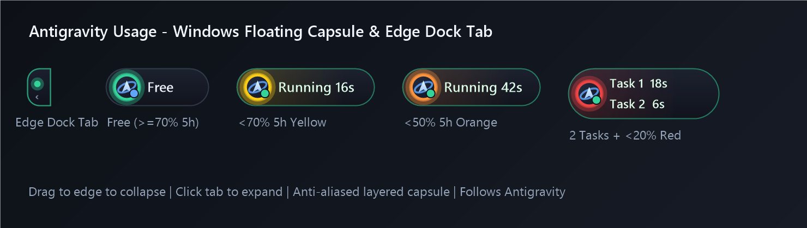

# Antigravity Usage

<div align="center">

**A modern, lightweight, private token tracking and usage dashboard for Google Antigravity.**

[](#)
[](LICENSE)
[](#)

[English](README.md) | [简体中文](README.zh-CN.md)

</div>

---

## ✨ Features

- **⚡ Real-time Session Capsule**: Embedded directly beside the input bar, displaying real-time generation speed (`tok/s`), token cache hits, and context window consumption.
- **📊 4-Tab Project & Usage Analytics**:
  - **Activity & Usage details**: Calendar heatmap, model breakdown chart & table, and 2×4 metric grid (Today, This week, This month, All time + Uncached Input, Cache Read, Output Tokens, Requests).
  - **This project & All projects**: Per-request daily project usage history (`usage-v1`), active days breakdown, and all-projects token ranking.
- **💱 Multi-Currency Switcher**: Top-right currency menu defaulting to **MYR (RM)** and supporting **USD ($)**, **CNY (¥)**, **EUR (€)**, **HKD (HK$)**, **TWD (NT$)**, **JPY (JP¥)**, and **GBP (£)**. Automatically remembers your selection.
- **🛡️ 128MB Memory Budget Hardening**: Prevents truncation or crashing during long-running sessions.
- **💾 Persistent Usage Ledger**: Built on local SQLite storage. Preserves historical usage statistics even when clearing or deleting chats.
- **📦 One-Click JSON Export**: Backup your complete historical usage ledger anytime.
- **🔄 In-App GitHub Release Updates**: Click **Check for updates** in the plugin menu to check and install new verified releases from [WilChew/antigravity-usage](https://github.com/WilChew/antigravity-usage/releases).
- **🪟 Windows Floating Status Capsule**: Ultra-compact, always-on-top desktop pill that stays visible even when Antigravity is minimized, synced to Antigravity's open/close lifecycle.

---

## 📸 Floating Capsule Preview & Guide



1. **Free (`>= 70%` 5h quota)**: Shows `Free` with a healthy green ring around the custom Orbital-Spark logo.
2. **Quota Warning Halo**: The logo halo shifts automatically as your 5-hour quota drops — **Yellow (`< 70%`)**, **Orange (`< 50%`)**, and **Red (`< 20%`)**.
3. **Live Elapsed Timer & Multi-Task View**: Displays `Running 16s` for a single active task, and automatically expands upward into a 2-row layout (`Task 1  18s` / `Task 2  6s`) when multiple tasks run concurrently.
4. **Taskbar-Safe & Lifecycle-Synced**: Anchors at the bottom-right corner above the taskbar, never overlaps the taskbar, and exits automatically when Antigravity closes.

---

## 🚀 Quick Start

### Installation

Clone the repository and run the installer:

```bash
# Clone repository
git clone https://github.com/WilChew/antigravity-usage.git
cd antigravity-usage

# Windows (PowerShell)
.\install.ps1

# Linux / macOS (Bash)
chmod +x install.sh
./install.sh
```

Or download `antigravity-usage-<version>.zip` from [GitHub Releases](https://github.com/WilChew/antigravity-usage/releases), extract it, and run:

```bash
python manage.py install
```

### Uninstallation

```bash
# Windows
.\uninstall.ps1

# Linux / macOS
./uninstall.sh
```

---

## ⚙️ Architecture

- **`compat/inline-widget.cjs`**: Lightweight Shadow DOM status bar capsule.
- **`compat/usage-ui.cjs`**: Full token usage modal dialog with 2-row layout and multi-currency picker.
- **`sidecars/panel/`**: Local background sidecar service managing the SQLite usage database.

---

## 📄 License

MIT License. See [LICENSE](LICENSE) for details.
