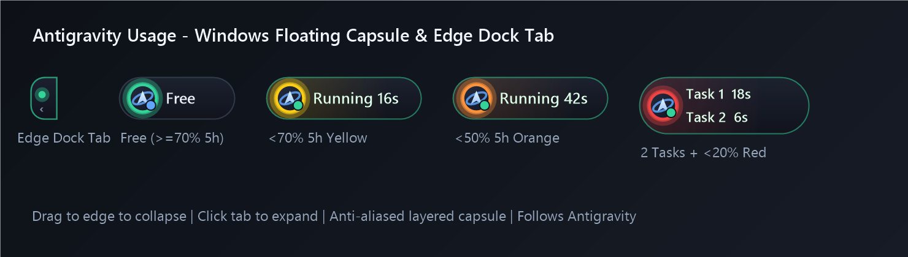

# Antigravity Usage

<div align="center">

**专为 Google Antigravity 打造的现代化、轻量级 Token 监控与用量统计插件。**

[](#)
[](LICENSE)
[](#)

[English](README.md) | [简体中文](README.zh-CN.md)

</div>

---

## ✨ 核心特性

- **⚡ 实时输入框胶囊**: 内嵌在输入框操作栏，实时显示当前单次对话的生成速度 (`tok/s`)、Token 缓存命中和上下文窗口占用率。
- **📊 四栏用量分析与项目统计**：
  - **Activity & Usage details**：日历热力图、按模型用量柱状图与明细表，以及 2×4 核心指标矩阵（今日、本周、本月、累计 + 未缓存输入、缓存读取、输出与请求/命中率）。
  - **This project & All projects**：基于逐请求时间戳账本（`usage-v1`）精准拆分的单项目每日消耗、活跃天数记录与全部项目排行榜。
- **💱 右上角多货币一键切换**：默认显示 **马币 (RM MYR)**，支持 **美元 ($ USD)**、**人民币 (¥ CNY)**、**欧元 (€ EUR)**、**港币 (HK$ HKD)**、**新台币 (NT$ TWD)**、**日元 (JP¥ JPY)** 和 **英镑 (£ GBP)**，选择后自动持久化记忆。
- **🛡️ 128MB 内存预算固化**：彻底消除超长会话 8MB 内存上限导致的统计截断问题。
- **💾 本地 SQLite 账本持久化**：即使清空或删除聊天会话历史，所有 Token 用量依然完整安全留存。
- **📦 一键导出 JSON 数据**：顶部直观的导出按钮，支持随时备份全量用量账本。
- **🔄 插件内检查与自动更新**：支持在插件菜单点击「检查更新」，直接从 [WilChew/antigravity-usage](https://github.com/WilChew/antigravity-usage/releases) 获取、校验并一键更新到新版本（保留所有本地账本与设置）。
- **🪟 Windows 桌面悬浮状态胶囊**：Antigravity 最小化后依然可在桌面右下角实时查看运行状态与 5 小时额度预警，并完全跟随 Antigravity 开关自动启停。

---

## 📸 悬浮窗截图与功能解说



1. **空闲状态（5h 额度 ≥ 70%）**：显示 `Free`，Logo 周围为健康的绿色光环。
2. **5 小时额度预警光环**：随着 5h 剩余额度降低，Logo 周围光环与左侧微光自动变色：**&lt; 70% 黄色**、**&lt; 50% 橙色**、**&lt; 20% 红色**。
3. **实时计时与多任务双排显示**：单任务显示 `Running 16s`；当 2 个及以上任务并行时，自动向上扩展为上下两排独立计时（`Task 1  18s` / `Task 2  6s`）。
4. **贴合工作区与自动退出**：默认停靠桌面右下角且严格限制在任务栏上方，支持左键拖拽与右键托盘菜单；关闭 Antigravity 时悬浮窗自动退出。

---

## 🚀 安装指南

### 快速安装

克隆本仓库并执行安装脚本：

```bash
# 克隆仓库
git clone https://github.com/WilChew/antigravity-usage.git
cd antigravity-usage

# Windows (PowerShell)
.\install.ps1

# Linux / macOS (Bash)
chmod +x install.sh
./install.sh
```

也可以前往 [GitHub Releases](https://github.com/WilChew/antigravity-usage/releases) 下载 `antigravity-usage-<version>.zip` 解压后运行安装脚本，或使用 Python 直接安装：

```bash
python manage.py install
```

### 卸载

```bash
# Windows
.\uninstall.ps1

# Linux / macOS
./uninstall.sh
```

---

## ⚙️ 目录结构

- **`compat/inline-widget.cjs`**: 输入框旁内联实时悬浮气泡胶囊。
- **`compat/usage-ui.cjs`**: 两排 8 格大窗口用量分析弹窗、多货币选择器及费用计算。
- **`sidecars/panel/`**: 本地 Node.js 后台服务与 SQLite 账本存储。

---

## 📄 开源许可

本项目遵循 MIT 开源许可协议，详情参见 [LICENSE](LICENSE)。
